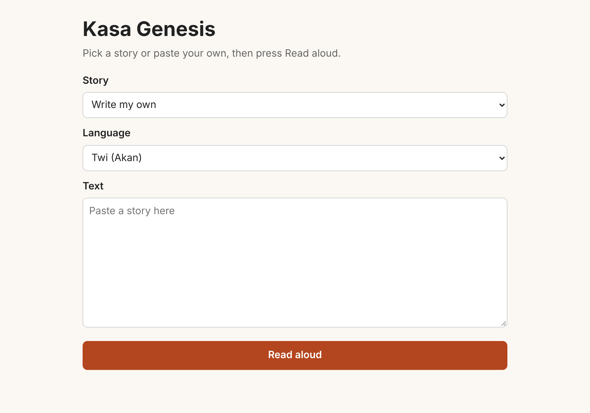

# Kasa Genesis

[](https://github.com/alfreddey/kasa-genesis/actions/workflows/ci.yml)

Kasa Genesis reads stories written in Ghanaian languages aloud. It is built for children aged about 4 to 10 and the parents who read with them, so children can hear stories in the languages spoken at home. Listening is the default, and read-along with word highlighting is planned (#15). Today you pick a bundled story or paste your own text, choose the language, and the app plays it back.



The page above is a temporary single HTML page; the Next.js web app (#3) replaces it. The product goals and roadmap live in issue #32, and the product spec in #79.

## Languages

| Language | Code | Model |
| --- | --- | --- |
| Twi (Akan) | `aka` | [facebook/mms-tts-aka](https://huggingface.co/facebook/mms-tts-aka) |
| Ewe | `ewe` | [facebook/mms-tts-ewe](https://huggingface.co/facebook/mms-tts-ewe) |

> **Licence note.** The MMS models come from Meta's Massively Multilingual Speech project and are licensed **CC-BY-NC 4.0**: research and non-commercial use only. We use them for local development only. The plan is to fine-tune our own voice from a commercially licensed base model; see the research in #7 and the base model choice in #23.

Ga is planned for a later release (#13). To add a language, see [CONTRIBUTING.md](CONTRIBUTING.md#add-a-language).

## Architecture

```
Browser ──► Next.js web app (web/, planned #3) ──► FastAPI API (api/) ──► TTS voice (Synthesizer)
                                                          │                  mms | tone | silent | module:Class
                                                          └──► stories/*.json
```

- **Web app**: today a single static page served by the API at `/`; the Next.js app in `web/` is coming in #3.
- **API**: FastAPI in `api/kasa/`. It splits text into sentences, normalizes the letters, synthesizes each sentence and returns one WAV.
- **Voice**: anything that implements the `Synthesizer` protocol in `api/kasa/tts.py`, chosen at startup with `KASA_VOICE`. Our own fine-tuned model will plug in here (#11).

## Quick start

Docker Compose is not set up yet (#5); once it is, `docker compose up` will start the web app and the API together. Until then, run the API directly as below.

## Local development

Python 3.10 or newer is required. From the repo root (`make help` lists every target):

```bash
make setup       # API + test deps, no model download
make test        # tests use a fake synthesizer, so they need no download or GPU
make setup-tts   # adds PyTorch and transformers for the real model
make run         # serves http://localhost:8000
make dev         # same, with an instant placeholder voice (no model needed)
make say TEXT="Akwaaba" LANG=aka VOICE=mms,tone   # write WAVs to compare voices
make experiment NAME=2026_11_topic                 # start a dated experiment folder
```

Without make:

```bash
cd api
python3 -m venv .venv && source .venv/bin/activate
pip install -e ".[tts,dev]"
pytest
uvicorn kasa.app:app --reload
```

The first time you read a story in a language, the model (about 150 MB) downloads from Hugging Face, so that first request is slow.

Settings the API reads are listed in [.env.example](.env.example): `KASA_VOICE`, `KASA_FLAGS` and `STORIES_DIR`.

The web app (`web/`) does not exist yet; its setup steps will be added here with #3.

## Experimenting

The repo is set up so an idea can be tried in minutes and thrown away cheaply:

- `make dev` runs the app with an instant placeholder voice, so no model is needed.
- `KASA_VOICE=module:Class make run` swaps in any voice, such as a fine-tuned model, without editing the app.
- `make say ... VOICE=mms,tone` writes one WAV per voice so you can listen side by side.
- Feature flags (`KASA_FLAGS=name`) keep unfinished features off by default.
- `make experiment NAME=...` creates a write-up folder under `experiments/`.

The full guide is [docs/experimentation.md](docs/experimentation.md).

## API

- `GET /api/languages` lists supported languages.
- `GET /api/stories` lists bundled stories; `GET /api/stories/{id}` returns one.
- `POST /api/speak` with `{"text": "Akwaaba.", "language": "aka"}` returns a WAV file.

These routes are moving under `/api/v1` (for example `POST /api/v1/tts` replaces `POST /api/speak`), with interactive docs at `/docs`, in #4. This section will point to `api/API.md` once that lands.

## Adding stories

Drop a JSON file in `stories/` (details in [CONTRIBUTING.md](CONTRIBUTING.md#add-a-story)):

```json
{ "id": "ananse-and-the-pot", "title": "Ananse and the Pot of Wisdom", "language": "aka", "text": "..." }
```

The two bundled stories are short greeting placeholders until real stories are added.

## Layout

- `api/`: the FastAPI service (`kasa` package, `pyproject.toml`, `tests/`).
- `stories/`: story files, shared by the API and the future web app. Override the path with `STORIES_DIR`.
- `docs/`: design notes and research.
- `experiments/`: dated experiment write-ups; `_template/` is the starter.
- `AGENTS.md`: a map of the code, commands and conventions for coding agents and new contributors.

The page at `api/kasa/static/index.html` is temporary; the Next.js app in `web/` (issue #3) replaces it.

## Contributing and licence

See [CONTRIBUTING.md](CONTRIBUTING.md) for branches, commits, tests and the pull request process.

The code is proprietary: see [LICENSE](LICENSE). Speech models, datasets and story texts carry their own licences, listed where they are used.
