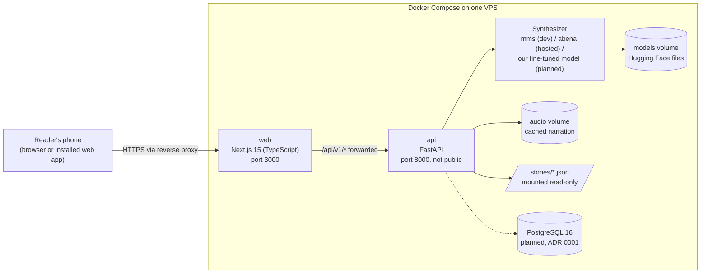

# Architecture

How the pieces fit together. The reasons behind each choice are in [adr/](adr/). This page describes what exists today and marks what is planned.

## The pieces

| Piece | What it does | Where it runs |
| --- | --- | --- |
| **Web app** (`web/`) | Screens for Home, Library, Saved, Parents and the story player. Fetches stories and plays audio. Phone first, with tablet and desktop layouts. | `web` container, port 3000. The only public port; a reverse proxy adds HTTPS. |
| **API** (`api/`) | The `/api/v1` contract: languages, stories, story audio, free-text TTS, feature flags. Rate limits new syntheses, logs request ids and serves `/metrics`. | `api` container. Reached by the web app by service name; also on `127.0.0.1:8000` for `/docs` and debugging. |
| **TTS backend** | Turns text into speech behind the `Synthesizer` interface. Chosen by `KASA_VOICE`: `mms` (local development only, non-commercial), `abena` (hosted, interim), `tone` and `silent` (placeholders). Our fine-tuned model replaces these for production (ADR 0006). | Inside the `api` container, or a hosted API. Weights live in the `models` volume. |
| **Stored audio** | Narration is cached by a hash of text, language, voice and model, so changing any of them never serves old audio. Pre-generated per-sentence storage is planned (ADR 0007). | `audio` volume (`CACHE_DIR`), or memory when unset. |
| **Stories** (`stories/`) | Story content as JSON, shared by `api` and `web`. Moves into the database later (#35). | Mounted read-only into `api`; restart `api` after editing. |
| **Database** | Accounts, child profiles, progress, subscriptions. Not built yet. | A `postgres:16` service in Compose, planned (ADR 0001, `docs/db-schema.md`). |

## A story play, step by step

1. The reader opens a story. `web` fetches `GET /api/v1/stories/{id}` for its text.
2. The audio element requests `GET /api/v1/stories/{id}/audio`.
3. `api` looks up the cache key. On a hit it returns the stored WAV at once, with an `ETag`.
4. On a miss it checks the per-client rate limit and the concurrency cap, asks the `Synthesizer` to read the text sentence by sentence, joins the chunks, stores the result and returns it. Too much load gives a `503` with `Retry-After`.

## Where to look next

- Run it: [docker.md](docker.md). API examples and versioning: [api.md](api.md). Debugging a running API: [observability.md](observability.md).
- Data model: [db-schema.md](db-schema.md). Writing stories: [content-guide.md](content-guide.md). Look and feel: [design-direction.md](design-direction.md).
