# Database schema

Status: proposed (issue #71). Decision record: [ADR 0001, PostgreSQL](adr/0001-postgresql.md).

This is the one design for every table the first release needs: stories and audio, parent accounts and child profiles, progress, freemium billing through Paystack or Hubtel, and admin tools. Features add their tables from this document instead of inventing them one at a time. Change this file in the same PR as any migration that departs from it.

It follows the product spec (#79). Three rules from the spec shape most of it:

1. **Collect the minimum about children.** A child profile holds a nickname, an avatar, an age band, languages and settings. There is no surname, birthday, photo, phone, email or free-text field about a child anywhere in the schema.
2. **Deleting a parent deletes everything about the family**, except payment records, which are kept for accounting with the personal parts removed.
3. **Money is an integer in minor units** (pesewas for GHS, pence for GBP, cents for USD), never a float.

## Contents

- [Conventions](#conventions)
- [ER diagram](#er-diagram)
- [Tables by domain](#tables-by-domain): [Content](#content), [Audio](#audio), [Accounts](#accounts), [Activity](#activity), [Billing](#billing), [Admin](#admin)
- [Constraints and indexes](#constraints-and-indexes)
- [Deleting a parent account](#deleting-a-parent-account)
- [Data retention](#data-retention)
- [Migration rules](#migration-rules)
- [Seed data](#seed-data)
- [Left out on purpose, and room for later](#left-out-on-purpose-and-room-for-later)

## Conventions

| Topic | Rule |
| --- | --- |
| Database | PostgreSQL 16 (see the ADR). Extensions: `citext` (emails), `pgcrypto` (only for `gen_random_bytes` in seeds). |
| Access | SQLAlchemy 2 (typed `Mapped[...]` models) with Alembic migrations in `api/migrations/`. |
| Primary keys | `id uuid`, UUID version 7, generated in Python (`uuid_utils.uuid7()` or the stdlib once on Python 3.14). v7 ids sort by creation time, so B-tree inserts stay local and ids leak no counts. Postgres 16 has no built-in v7 generator, so there is no `DEFAULT` on the column. Exceptions: `languages` uses its ISO 639-3 code, and pure join tables use a composite key. |
| Times | Every time column is `timestamptz`, stored in UTC. Names end in `_at`. Calendar days (for aggregates) are `date` in UTC. |
| Audit columns | Every table that can change has `created_at timestamptz not null default now()` and `updated_at timestamptz not null default now()`, kept current by the ORM. Append-only tables (events, audit log) have only `created_at` or `occurred_at`. |
| Enums | Stored as `text` with a `CHECK (col IN (...))` constraint, not Postgres `ENUM` types. Adding a value is then a constraint swap in one migration, which is easy to reverse. The allowed values are listed per table below. |
| Money | `amount_minor bigint not null CHECK (amount_minor >= 0)` plus `currency char(3)` (ISO 4217, upper case). Never `numeric` for stored amounts and never `float`. |
| Text | `text` with `CHECK (char_length(...) <= n)` where a limit matters, rather than `varchar(n)`. Story text is Unicode NFC, as `normalize_text` in `api/kasa/text.py` produces. |
| Secrets | Login codes and session tokens are stored only as SHA-256 hashes. Raw values never touch the database or logs. |
| Soft delete | Only `payments` (legal requirement to keep). Everything else is deleted for real, so "delete my data" means it is gone. Stories use `status = 'archived'`, which is a workflow state, not a soft delete. |
| Naming | Tables are plural `snake_case`. Foreign keys are `<thing>_id`. Constraints are named by the Alembic naming convention (`pk_`, `fk_`, `uq_`, `ck_`, `ix_`) so migrations can drop them by name. |

## ER diagram

Columns are trimmed to keys and the fields that explain a relationship. The full column list is in each table's notes.

```mermaid
erDiagram
    languages ||--o{ stories : "written in"
    languages ||--o{ voices : "speaks"
    stories ||--o{ story_paragraphs : "has"
    stories ||--o{ credits : "credits"
    stories }o--o{ tags : "story_tags"
    assets |o--o{ stories : "cover"
    assets |o--o{ story_paragraphs : "illustration"
    model_versions ||--o{ voices : "powers"
    voices ||--o{ audio_segments : "renders"
    story_paragraphs ||--o{ audio_segments : "audio for"
    stories ||--o{ audio_jobs : "queued for"
    voices ||--o{ audio_jobs : "uses"

    parents ||--o{ sessions : "signs in"
    parents ||--o{ child_profiles : "has"
    child_profiles }o--o{ languages : "child_profile_languages"
    child_profiles ||--o{ reading_progress : "tracks"
    child_profiles ||--o{ favorites : "likes"
    child_profiles |o--o{ listening_events : "plays"
    stories ||--o{ reading_progress : ""
    stories ||--o{ favorites : ""
    stories ||--o{ listening_events : ""
    stories ||--o{ listening_daily_stats : "rolled up"

    plans ||--o{ subscriptions : "priced by"
    parents |o--o{ subscriptions : "buys"
    subscriptions |o--o{ payments : "billed by"
    parents |o--o{ payments : "paid"
    plans ||--o{ payments : "for"
    parents ||--o{ entitlements : "may access"
    subscriptions |o--o{ entitlements : "grants"
    webhook_events |o--o| payments : "confirms"

    admin_users ||--o{ audit_log : "acts"
    admin_users |o--o{ stories : "reviews"

    languages {
        text code PK "ISO 639-3: aka, ewe, gaa"
        text name
        bool is_enabled
    }
    stories {
        uuid id PK
        text slug UK
        text language_code FK
        text status "draft, in_review, published, archived"
        smallint level "1 to 4"
        text age_band "4-6, 7-10, all"
        bool is_free
        uuid cover_asset_id FK
        uuid reviewed_by_admin_id FK
        timestamptz published_at
    }
    story_paragraphs {
        uuid id PK
        uuid story_id FK
        int position "unique per story"
        text text
        uuid illustration_asset_id FK
    }
    credits {
        uuid id PK
        uuid story_id FK
        text role
        text name
        text license
    }
    assets {
        uuid id PK
        text kind
        text storage_key UK
        text sha256 UK
    }
    tags {
        uuid id PK
        text slug UK
    }
    model_versions {
        uuid id PK
        text name UK
        text base_model
        text license
        bool commercial_use_ok
    }
    voices {
        uuid id PK
        text slug UK
        text language_code FK
        uuid model_version_id FK
        bool is_default
    }
    audio_segments {
        uuid id PK
        text cache_key UK
        uuid paragraph_id FK
        uuid voice_id FK
        text normalizer_version
        text storage_key
        int duration_ms
        jsonb word_timings
    }
    audio_jobs {
        uuid id PK
        text kind
        text status
        uuid story_id FK
        uuid voice_id FK
        smallint attempts
        timestamptz run_after
    }
    parents {
        uuid id PK
        text phone_e164 UK
        citext email UK
        text locale
        text country_code
        timestamptz consent_given_at
    }
    auth_codes {
        uuid id PK
        text channel "sms, email"
        text destination_hash
        text code_hash
        timestamptz expires_at
    }
    sessions {
        uuid id PK
        uuid parent_id FK
        text token_hash UK
        timestamptz expires_at
    }
    child_profiles {
        uuid id PK
        uuid parent_id FK
        text nickname
        text avatar_key
        text age_band
        bool read_along_default
    }
    reading_progress {
        uuid child_profile_id PK
        uuid story_id PK
        int last_paragraph_position
        int last_sentence_index
        timestamptz finished_at
    }
    favorites {
        uuid child_profile_id PK
        uuid story_id PK
    }
    listening_events {
        uuid id PK
        uuid child_profile_id FK "null for guests"
        uuid story_id FK
        text event
        timestamptz occurred_at
    }
    listening_daily_stats {
        date day PK
        uuid story_id PK
        text age_band PK
        bool read_along PK
        int starts
        int finishes
    }
    plans {
        uuid id PK
        text code UK
        text interval "month, year"
        bigint price_minor
        char currency
    }
    subscriptions {
        uuid id PK
        uuid parent_id FK "set null on delete"
        uuid plan_id FK
        text provider "paystack, hubtel"
        text provider_subscription_code
        text status
        timestamptz current_period_end
    }
    payments {
        uuid id PK
        uuid parent_id FK "set null on delete"
        uuid subscription_id FK
        uuid plan_id FK
        text provider
        text provider_reference
        bigint amount_minor
        char currency
        text status
        timestamptz anonymized_at
    }
    entitlements {
        uuid id PK
        uuid parent_id FK
        uuid subscription_id FK
        text feature
        timestamptz starts_at
        timestamptz ends_at
    }
    webhook_events {
        uuid id PK
        text provider
        text idempotency_key
        jsonb payload
        timestamptz processed_at
    }
    admin_users {
        uuid id PK
        citext email UK
        text role "reviewer, editor, admin"
    }
    audit_log {
        uuid id PK
        uuid actor_admin_id FK
        text action
        text entity_type
        uuid entity_id
        timestamptz created_at
    }
```

## Tables by domain

Each table lists its columns, then a short note on why it looks the way it does. `PK`, `FK`, `UK` mark primary, foreign and unique keys; "not null" is the default unless a column says "nullable".

### Content

Replaces the JSON files in `stories/` (#35). The JSON files stay as the import format for dev seeds and the African Storybook importer (#36).

**`languages`**: `code text PK` (ISO 639-3, matches `api/kasa/languages.py`), `name text`, `native_name text`, `is_enabled bool default false`, timestamps.
A tiny lookup table keyed by its code, because the code is already a stable, meaningful id used in URLs and story files. Ga (`gaa`) is seeded with `is_enabled = false` until it ships. Model ids do not live here; they belong to `voices`.

**`stories`**: `id`, `slug text UK`, `language_code FK -> languages`, `title text`, `summary text nullable`, `status text` (`draft`, `in_review`, `published`, `archived`), `level smallint CHECK (level BETWEEN 1 AND 4)`, `age_band text` (`4-6`, `7-10`, `all`), `is_free bool default false`, `cover_asset_id FK -> assets nullable`, `source text nullable` (for example `african-storybook`), `source_id text nullable`, `reviewed_by_admin_id FK -> admin_users nullable`, `reviewed_at nullable`, `published_at nullable`, timestamps.
`is_free` is the freemium switch on each story; the paywall (#76) reads it together with `entitlements`. `CHECK (status <> 'published' OR published_at IS NOT NULL)` keeps published stories dated. `UNIQUE (source, source_id)` stops the importer from creating duplicates. The slug is globally unique (for example `anansi-pot-of-wisdom-aka`), which keeps share links simple.

**`story_paragraphs`**: `id`, `story_id FK -> stories ON DELETE CASCADE`, `position int CHECK (position >= 0)`, `text text`, `illustration_asset_id FK -> assets nullable`, timestamps. `UNIQUE (story_id, position)`.
A paragraph is the unit of audio generation and of "pages" in the reader. Sentences are not stored: they are derived from the text by the same splitter the TTS uses, and `reading_progress.last_sentence_index` counts within a paragraph. Reordering paragraphs uses a deferred unique constraint (`DEFERRABLE INITIALLY DEFERRED`) so positions can swap inside one transaction.

**`credits`**: `id`, `story_id FK -> stories ON DELETE CASCADE`, `role text` (`author`, `illustrator`, `translator`, `adapter`, `reviewer`), `name text`, `license text` (SPDX-like, for example `CC-BY-4.0`), `source_url text nullable`, `position smallint`, timestamps.
The spec says credits always travel with the story (#49), so a story cannot be published without at least one `author` credit and a license. That rule is checked by the publish endpoint (and a test), since it spans rows.

**`assets`**: `id`, `kind text` (`cover`, `illustration`, `avatar`, `ui`, `audio_prompt`), `storage_key text UK` (object-store path), `mime_type text`, `bytes int`, `width int nullable`, `height int nullable`, `sha256 text UK`, `license text`, `attribution text nullable`, timestamps.
Files live in object storage, never in the database. `sha256` is unique so the same image uploaded twice is stored once. Child avatars are a fixed, designed set (#62) seeded as `kind = 'avatar'`; profiles reference them by `avatar_key`, never by an uploaded photo.

**`tags`** and **`story_tags`**: `tags(id, slug UK, name)`, and `story_tags(story_id FK ON DELETE CASCADE, tag_id FK ON DELETE CASCADE, PK (story_id, tag_id))`.
Themes such as `animals`, `anansi`, `bedtime` for library filters. Tag names are English in the first release; translated names wait for #48.

### Audio

Audio is generated once per paragraph and voice, stored, and served from storage (#12, #37).

**`model_versions`**: `id`, `name text UK` (for example `kasa-twi-v1.2`), `base_model text`, `license text`, `commercial_use_ok bool`, `checkpoint_uri text`, `eval_report_url text nullable` (#22), `released_at nullable`, timestamps.
Records exactly which weights produced each clip, so a bad model can be found and its audio regenerated. `commercial_use_ok` lets a check stop a non-commercial base (such as MMS) from being made a default voice in production (#34).

**`voices`**: `id`, `slug text UK` (for example `twi-ama`), `language_code FK -> languages`, `model_version_id FK -> model_versions ON DELETE RESTRICT`, `display_name text`, `is_default bool default false`, `is_enabled bool`, timestamps. Partial unique index: one default voice per language, `UNIQUE (language_code) WHERE is_default`.
A voice is what the app picks; a model version is what produced it. A new model release is a new `model_versions` row and an update of the voice's `model_version_id`, which makes the cache keys change and triggers regeneration.

**`audio_segments`**: `id`, `cache_key text UK`, `paragraph_id FK -> story_paragraphs ON DELETE CASCADE`, `voice_id FK -> voices ON DELETE RESTRICT`, `model_version_id FK -> model_versions ON DELETE RESTRICT`, `normalizer_version text`, `text_sha256 text`, `storage_key text`, `format text` (`opus`, `mp3`), `bytes int`, `duration_ms int CHECK (duration_ms > 0)`, `word_timings jsonb`, `created_at`.
`cache_key = sha256(model_version.name | voice.slug | normalizer_version | sha256(normalized paragraph text) | format)`. If any input changes, the key changes and the old row is simply no longer used, so a stale clip can never be served. `word_timings` is a JSON array of `{"w": word, "s": start_ms, "e": end_ms}` for read-along and tap-a-word (#15, #57); it is read as a whole with the clip, never queried inside, so `jsonb` is the right fit. `normalizer_version` is a constant next to `normalize_text` that is bumped whenever its output changes. Old segments are deleted by a cleanup job (see retention).

**`audio_jobs`**: `id`, `kind text` (`generate_story`, `generate_paragraph`, `regenerate_voice`), `status text` (`queued`, `running`, `succeeded`, `failed`, `cancelled`), `story_id FK -> stories ON DELETE CASCADE nullable`, `voice_id FK -> voices ON DELETE CASCADE`, `params jsonb default '{}'`, `attempts smallint default 0`, `max_attempts smallint default 3`, `run_after timestamptz default now()`, `locked_by text nullable`, `locked_at nullable`, `last_error text nullable`, `finished_at nullable`, timestamps.
Built so a worker can take jobs with `SELECT ... FOR UPDATE SKIP LOCKED`, which means no extra queue service is needed at our size. If #37 picks a broker instead, this table still records job history for the admin screens (#38).

### Accounts

Parents sign in with a phone number or email and a one-time code (#69). Children never sign in; they pick a profile under the parent's session (#70).

**`parents`**: `id`, `phone_e164 text UK nullable` (for example `+233241234567`), `email citext UK nullable`, `display_name text nullable`, `locale text default 'en-GH'`, `country_code char(2)`, `consent_version text`, `consent_given_at timestamptz`, `parent_gate_pin_hash text nullable`, `last_seen_at nullable`, timestamps. `CHECK (phone_e164 IS NOT NULL OR email IS NOT NULL)`.
`consent_version` and `consent_given_at` record when the parent agreed to the privacy notice and created child profiles, which is the evidence of parental consent that #78 is working out for Act 843, COPPA and GDPR. `country_code` decides prices and payment methods, not anything about the child. There is deliberately no address, date of birth or ID number.

**`auth_codes`**: `id`, `channel text` (`sms`, `email`), `destination_hash text` (SHA-256 of the normalized phone or email, with a server-side pepper), `code_hash text`, `purpose text` (`sign_in`, `change_contact`, `delete_account`), `attempts smallint default 0`, `expires_at`, `consumed_at nullable`, `created_at`. Index on `(destination_hash, created_at desc)`.
Not linked to `parents` by a foreign key, because a code is sent before the account exists on first sign-up. Rate limits (#17) count recent rows per `destination_hash`. Codes live about 10 minutes and the rows are deleted after a day.

**`sessions`**: `id`, `parent_id FK -> parents ON DELETE CASCADE`, `token_hash text UK`, `device_label text nullable` (for example "Chrome on Android", parsed and short, not the raw user agent), `created_at`, `last_used_at`, `expires_at`, `revoked_at nullable`. Index on `(parent_id)`.
Server-side sessions so a parent can sign out a lost phone from "Devices". No IP addresses are stored here; security logs keep a truncated IP for a short time instead (#39).

**`child_profiles`**: `id`, `parent_id FK -> parents ON DELETE CASCADE`, `nickname text CHECK (char_length(nickname) BETWEEN 1 AND 20)`, `avatar_key text` (one of the seeded avatar assets), `age_band text` (`4-6`, `7-10`), `read_along_default bool`, `playback_rate numeric(3,2) default 1.00 CHECK (playback_rate BETWEEN 0.5 AND 1.5)`, `position smallint`, timestamps. `UNIQUE (parent_id, nickname)`.
Exactly the fields the spec allows. The nickname is free text typed by a parent, so the UI suggests a first name or pet name and the privacy policy says not to use full names. `read_along_default` defaults by age band (on for `7-10`, off for `4-6`) in the API, not in the database, so the rule can change without a migration. The number of profiles per parent (for example 6) is enforced in the API.

**`child_profile_languages`**: `child_profile_id FK -> child_profiles ON DELETE CASCADE`, `language_code FK -> languages ON DELETE RESTRICT`, `PK (child_profile_id, language_code)`.
A join table instead of a `text[]` column, so each language is checked against `languages` by a foreign key.

### Activity

**`reading_progress`**: `child_profile_id FK -> child_profiles ON DELETE CASCADE`, `story_id FK -> stories ON DELETE CASCADE`, `PK (child_profile_id, story_id)`, `last_paragraph_position int default 0`, `last_sentence_index int default 0`, `times_finished int default 0`, `first_finished_at nullable`, `last_finished_at nullable`, `updated_at`. Index on `(child_profile_id, updated_at desc)` for "keep listening".
One row per child and story, updated in place with an upsert, so it never grows beyond the number of stories a child has opened. "5 stories finished" is `count(*) WHERE first_finished_at IS NOT NULL`. A position is a paragraph and a sentence within it, not a time in seconds, so it survives a regenerated clip with different timing.

**`favorites`**: `child_profile_id FK ON DELETE CASCADE`, `story_id FK ON DELETE CASCADE`, `PK (child_profile_id, story_id)`, `created_at`.

**`listening_events`**: `id`, `child_profile_id FK -> child_profiles ON DELETE CASCADE nullable` (null for guests), `story_id FK -> stories ON DELETE CASCADE`, `voice_id FK -> voices ON DELETE SET NULL nullable`, `event text` (`start`, `finish`, `read_along_on`, `read_along_off`, `word_tap`, `download`), `read_along bool`, `age_band text nullable` (copied from the profile at the time), `occurred_at`. Range-partitioned by month on `occurred_at`, so the primary key is `(id, occurred_at)`, as Postgres requires the partition key in it; indexes on `(occurred_at)` and `(child_profile_id, occurred_at)`.
Raw events exist only to compute the spec's metrics (completion rate, stories per child per week, read-along use). There is no device id, IP address or free text. Guests produce events with no profile at all. Monthly partitions make the 90-day retention a cheap `DROP` of an old partition instead of a large `DELETE`.

**`listening_daily_stats`**: `day date`, `story_id FK -> stories ON DELETE CASCADE`, `language_code text`, `age_band text` (`4-6`, `7-10`, `guest`), `read_along bool`, `PK (day, story_id, age_band, read_along)`, `starts int`, `finishes int`, `word_taps int`, `distinct_profiles int`.
The long-term, anonymous rollup that the raw events are folded into each night. It has no link to any child, so it can be kept and does not need to be deleted with an account.

### Billing

Prices, subscriptions and payments through Paystack or Hubtel (#76, #77). Which provider wins is still open (#77), so every provider-specific id sits next to a `provider` column and both can coexist.

**`plans`**: `id`, `code text UK` (for example `family-monthly-ghs`), `name text`, `interval text` (`month`, `year`), `price_minor bigint CHECK (price_minor >= 0)`, `currency char(3)`, `country_codes text[] nullable` (where the price applies; null means everywhere), `provider_plan_codes jsonb default '{}'` (for example `{"paystack": "PLN_abc"}`), `trial_days smallint default 0`, `is_active bool`, timestamps.
Plans are never edited once a payment references them; a price change is a new plan row with the old one set inactive, so receipts always match what the parent agreed to. GH₵ 25.00 is stored as `2500` with `GHS`.

**`subscriptions`**: `id`, `parent_id FK -> parents ON DELETE SET NULL nullable`, `plan_id FK -> plans ON DELETE RESTRICT`, `provider text` (`paystack`, `hubtel`), `provider_customer_code text nullable`, `provider_subscription_code text nullable`, `status text` (`incomplete`, `active`, `past_due`, `cancelled`, `expired`), `renews bool` (false for MoMo plans paid one period at a time), `current_period_start`, `current_period_end`, `cancel_at_period_end bool default false`, `cancelled_at nullable`, `renewal_reminder_sent_at nullable`, timestamps. `UNIQUE (provider, provider_subscription_code)`; partial unique `UNIQUE (parent_id) WHERE status IN ('active', 'past_due')` so a parent has at most one live plan.
MoMo often cannot be charged automatically, so a subscription may be a chain of one-off payments that each extend `current_period_end`; `renews` records which kind it is. `renewal_reminder_sent_at` backs the spec's "remind me before my plan renews". On account deletion the row is cancelled at the provider first, then `parent_id` is set to null so the history stays consistent with `payments`.

**`payments`**: `id`, `parent_id FK -> parents ON DELETE SET NULL nullable`, `subscription_id FK -> subscriptions ON DELETE SET NULL nullable`, `plan_id FK -> plans ON DELETE RESTRICT`, `provider text`, `provider_reference text`, `amount_minor bigint CHECK (amount_minor > 0)`, `currency char(3)`, `status text` (`pending`, `succeeded`, `failed`, `abandoned`, `refunded`), `channel text nullable` (`mobile_money`, `card`, `bank`), `mobile_network text nullable` (`mtn`, `telecel`, `at`), `payer_country char(2) nullable`, `failure_reason text nullable`, `paid_at nullable`, `refunded_at nullable`, `anonymized_at nullable`, `deleted_at nullable`, timestamps. `UNIQUE (provider, provider_reference)`; index on `(parent_id, created_at desc)` for receipts.
The only table with soft delete. The reference is generated by us before redirecting to the provider, so a retry of the same checkout reuses it and cannot create a second charge. No phone number, card number, card last four or email is copied here; the provider holds those and our receipt view asks the provider for them while the account exists. After anonymization the row still shows what was paid, when, in what currency and for which plan, which is what accounting needs.

**`entitlements`**: `id`, `parent_id FK -> parents ON DELETE CASCADE`, `feature text` (`premium_library`, `offline_downloads`), `source text` (`subscription`, `grant`, `trial`), `subscription_id FK -> subscriptions ON DELETE SET NULL nullable`, `granted_by_admin_id FK -> admin_users ON DELETE SET NULL nullable`, `starts_at`, `ends_at nullable`, `revoked_at nullable`, timestamps. `CHECK (ends_at IS NULL OR ends_at > starts_at)`; index on `(parent_id, feature, ends_at)`.
What a parent can access right now, kept separate from how they paid, so the paywall check (#76) is one indexed query: a row for this parent and feature where `starts_at <= now() < coalesce(ends_at, 'infinity')` and `revoked_at IS NULL`. Payments and webhooks write entitlements; the reader and download endpoints only read them. Grants (for example a reviewer's family or a school pilot) need no fake payment. The offline grace period (spec question 12) is `ends_at` plus a configured number of days, checked by the download licence, not stored.

**`webhook_events`**: `id`, `provider text`, `idempotency_key text`, `event_type text`, `payload jsonb`, `signature_valid bool`, `payment_id FK -> payments ON DELETE SET NULL nullable`, `received_at`, `processed_at nullable`, `processing_error text nullable`, `attempts smallint default 0`. `UNIQUE (provider, idempotency_key)`; partial index on `(received_at) WHERE processed_at IS NULL`.
Every webhook is stored before it is acted on, then processed in a transaction; a repeat delivery hits the unique key and is acknowledged without being applied twice. Paystack events have no single event id, so `idempotency_key = sha256(event + data.id + data.reference + data.status)`; Hubtel uses its transaction id and status the same way. The payload contains the payer's contact details, so it is kept only 90 days (see retention).

### Admin

**`admin_users`**: `id`, `email citext UK`, `display_name text`, `role text` (`reviewer`, `editor`, `admin`), `password_hash text nullable` or SSO subject, `mfa_enabled bool`, `last_sign_in_at nullable`, `disabled_at nullable`, timestamps.
Staff and native-speaker reviewers, kept apart from `parents` so a parent account can never gain admin rights. One role per person is enough for now: `reviewer` checks text and audio, `editor` also publishes and manages credits and voices, `admin` also manages staff, grants and refunds. A role table can replace the column if permissions get finer.

**`audit_log`**: `id`, `actor_admin_id FK -> admin_users ON DELETE SET NULL nullable`, `actor_label text` (kept even if the admin row goes), `action text` (for example `story.publish`, `entitlement.grant`, `payment.refund`, `parent.delete`), `entity_type text`, `entity_id uuid nullable`, `changes jsonb nullable` (before and after for changed fields), `created_at`. Index on `(entity_type, entity_id, created_at desc)` and `(created_at)`.
Append-only: the application's database role has `INSERT` and `SELECT` but not `UPDATE` or `DELETE` on it. `changes` never holds a child's nickname or a parent's contact details; for a deletion it records only the ids and counts.

## Constraints and indexes

### Unique keys

| Table | Unique key | Why |
| --- | --- | --- |
| `stories` | `slug` | Stable share URLs. |
| `stories` | `(source, source_id)` | The importer can re-run without creating duplicates. |
| `story_paragraphs` | `(story_id, position)`, deferrable | Paragraph order is unambiguous. |
| `assets` | `storage_key`, `sha256` | One file, one row. |
| `tags` | `slug` | |
| `model_versions` | `name` | |
| `voices` | `slug`; `(language_code) WHERE is_default` | One default voice per language. |
| `audio_segments` | `cache_key` | Generate each clip once. |
| `parents` | `phone_e164`, `email` (both nullable) | One account per contact. |
| `sessions` | `token_hash` | |
| `child_profiles` | `(parent_id, nickname)` | Avoids two "Kofi" tiles on "Who is reading?". |
| `plans` | `code` | |
| `subscriptions` | `(provider, provider_subscription_code)`; `(parent_id) WHERE status IN ('active','past_due')` | One live plan per parent. |
| `payments` | `(provider, provider_reference)` | A checkout can never be recorded or charged twice. |
| `webhook_events` | `(provider, idempotency_key)` | Repeat deliveries are ignored. |
| `admin_users` | `email` | |

### Foreign keys and `ON DELETE`

The rule of thumb: rows that belong to a family cascade from the parent; content rows cascade from their story; money rows are never deleted by a cascade; reference data (languages, plans, model versions, voices in use) is `RESTRICT`, so it has to be retired rather than deleted.

| Child table → parent | On delete |
| --- | --- |
| `stories.language_code` → `languages` | RESTRICT |
| `stories.cover_asset_id`, `story_paragraphs.illustration_asset_id` → `assets` | SET NULL |
| `stories.reviewed_by_admin_id` → `admin_users` | SET NULL |
| `story_paragraphs`, `credits`, `story_tags`, `audio_jobs.story_id` → `stories` | CASCADE |
| `story_tags.tag_id` → `tags` | CASCADE |
| `audio_segments.paragraph_id` → `story_paragraphs` | CASCADE |
| `audio_segments.voice_id`, `.model_version_id`; `voices.model_version_id` | RESTRICT |
| `voices.language_code` → `languages` | RESTRICT |
| `sessions`, `child_profiles`, `entitlements` → `parents` | CASCADE |
| `child_profile_languages`, `reading_progress`, `favorites`, `listening_events` → `child_profiles` | CASCADE |
| `child_profile_languages.language_code` → `languages` | RESTRICT |
| `reading_progress`, `favorites`, `listening_events`, `listening_daily_stats` → `stories` | CASCADE |
| `listening_events.voice_id` → `voices` | SET NULL |
| `subscriptions.parent_id`, `payments.parent_id` → `parents` | SET NULL (with anonymization, below) |
| `payments.subscription_id`, `entitlements.subscription_id` → `subscriptions` | SET NULL |
| `subscriptions.plan_id`, `payments.plan_id` → `plans` | RESTRICT |
| `webhook_events.payment_id` → `payments` | SET NULL |
| `entitlements.granted_by_admin_id`, `audit_log.actor_admin_id` → `admin_users` | SET NULL |

The API only deletes stories that were never published; published stories are archived, so progress, favorites and stats are kept. The cascades are there so a draft can be removed cleanly.

### Indexes for the main queries

Every foreign key column that is not the leading column of a primary or unique key gets its own index, because Postgres does not create them and cascades would otherwise scan whole tables.

| Query | Index |
| --- | --- |
| Library: published stories by language, filtered by level, age band and free | `ix_stories_library ON stories (language_code, level, age_band) WHERE status = 'published'` |
| Library: newest first | `ON stories (language_code, published_at DESC) WHERE status = 'published'` |
| Library: filter by tag | `ON story_tags (tag_id, story_id)` |
| Reader: paragraphs of a story in order | primary use of `UNIQUE (story_id, position)` |
| Reader: audio for a paragraph and voice | `UNIQUE (cache_key)`, plus `ON audio_segments (paragraph_id, voice_id)` |
| "Keep listening" for a child | `ON reading_progress (child_profile_id, updated_at DESC)` |
| "Finished" count and favorites for a child | primary keys of `reading_progress` and `favorites` |
| Paywall check | `ON entitlements (parent_id, feature, ends_at)` |
| Receipts | `ON payments (parent_id, created_at DESC)` |
| Renewal reminders | `ON subscriptions (current_period_end) WHERE status = 'active'` |
| Job worker | `ON audio_jobs (run_after) WHERE status = 'queued'` |
| Unprocessed webhooks | `ON webhook_events (received_at) WHERE processed_at IS NULL` |
| Sign-in rate limit | `ON auth_codes (destination_hash, created_at DESC)` |
| Admin history of one record | `ON audit_log (entity_type, entity_id, created_at DESC)` |

## Deleting a parent account

"Delete my account" (#69) runs as one job and one transaction, then is audited:

1. Cancel any live subscription at the provider (Paystack or Hubtel). If the provider call fails, stop and retry later; the account is not deleted with a subscription still able to charge.
2. Anonymize money records: `UPDATE payments SET anonymized_at = now(), failure_reason = NULL WHERE parent_id = :id`, and the same for `subscriptions` (clear `provider_customer_code`). Delete `webhook_events` linked to those payments, since their payloads contain the payer's contact details.
3. `DELETE FROM parents WHERE id = :id`. The cascades remove sessions, entitlements, child profiles and, through child profiles, their languages, progress, favorites and raw listening events. `payments.parent_id` and `subscriptions.parent_id` become null.
4. Delete outstanding `auth_codes` for the parent's phone and email hashes.
5. Write `audit_log` with action `parent.delete`, the parent id and the number of profiles removed, and nothing else.

What is left afterwards: anonymized payment rows (amount, currency, plan, provider reference, dates, status) and anonymous daily stats. The provider reference lets our accountant match a payment to the provider's own records, which the provider keeps under its own legal duty.

Backups still hold the deleted data until they expire (30 days, see below). The privacy policy says so, and a restore from backup re-runs the deletion log so deleted accounts do not come back.

## Data retention

Linked from the privacy work in the product spec (#79, section 10) and tracked in #78. Periods marked "proposed" are first guesses for #78 to confirm against Act 843, COPPA and GDPR; the job that enforces each one runs nightly and is tested.

| Table | Kept for | Then | Notes |
| --- | --- | --- | --- |
| `languages`, `stories`, `story_paragraphs`, `credits`, `tags`, `assets` | While in use | Archived stories are kept so credits stay traceable | Content, not personal data. |
| `model_versions`, `voices` | Forever | | Provenance of every clip. |
| `audio_segments` | While their cache key is current | Rows and files not served for 30 days after being superseded are deleted | Old clips are regenerable. |
| `audio_jobs` | 90 days after finishing | Deleted | |
| `parents` | Until the parent deletes the account, or 24 months with no sign-in (proposed) | Account deleted as above, after two reminder messages | Inactivity rule needs #78 sign-off. |
| `auth_codes` | 24 hours | Deleted | Codes expire after about 10 minutes. |
| `sessions` | Until expiry (30 days idle, 90 days absolute) or revocation | Deleted 7 days later | |
| `child_profiles`, `child_profile_languages`, `reading_progress`, `favorites` | Until the parent deletes the profile or account | Deleted (cascade) | |
| `listening_events` | 90 days | Rolled up into `listening_daily_stats`, then the monthly partition is dropped | Raw, profile-linked data is short-lived. |
| `listening_daily_stats` | Forever | | Anonymous; cannot be linked to a child. |
| `plans` | Forever | Inactive plans stay for receipts | |
| `subscriptions` | Life of the account plus the payments period | Anonymized on account deletion | |
| `payments` | 7 years from the payment date (proposed; confirm with an accountant and #78) | Hard-deleted after that | Anonymized on account deletion; `deleted_at` hides a row from the app early when needed. |
| `entitlements` | Life of the account | Expired rows older than 2 years deleted | |
| `webhook_events` | 90 days | Deleted | Payloads contain payer contact details. |
| `admin_users` | While staff | Disabled, then deleted after 2 years | |
| `audit_log` | 2 years (proposed) | Deleted | Never contains child data. |
| Backups | 30 days | Expire | Point-in-time recovery window. |

## Migration rules

1. **Alembic only.** Every schema change is an Alembic revision in `api/migrations/versions/`, generated with `--autogenerate`, then read and edited by hand. No manual changes on the production database.
2. **Reversible or labelled.** Each revision has a working `downgrade()`. If that is impossible (a dropped column's data cannot come back), `downgrade()` raises and the docstring starts with `ONE-WAY:` and says why. Data migrations live in their own revisions, apart from schema changes.
3. **Tested in CI against real Postgres 16** (a service container in #6): `alembic upgrade head`, then `alembic downgrade base`, then `upgrade head` again, then the test suite; and `alembic check` fails the build if the models and migrations disagree. SQLite is never used as a stand-in.
4. **Zero downtime: expand, then contract.** The old and new app versions must both work while a deploy rolls out. Renaming a column, for example, is four steps across at least two deploys:
   1. Add the new column, nullable.
   2. Write to both columns and backfill the old rows in batches.
   3. Switch reads to the new column, then add `NOT NULL` once it is full.
   4. In a later release, stop writing the old column and drop it.
5. **Safe operations on large tables.** Create indexes with `CREATE INDEX CONCURRENTLY` (in an Alembic revision with `autocommit_block`). Add foreign keys and checks as `NOT VALID`, then `VALIDATE CONSTRAINT` in a separate step. Set `lock_timeout = '5s'` in migrations so a blocked migration fails fast instead of stalling the app. Adding a column with a constant default is fine on Postgres 16; adding one with a volatile default is not.
6. **One concern per revision**, small enough to review, named for what it does (for example `0007_add_child_profile_languages`).
7. **This document is updated in the same PR** as a migration that changes it.

## Seed data

For development and tests (#40). Seeds are idempotent Python scripts (`make seed`) that upsert by natural key, never Alembic data migrations, so they can be re-run and never reach production by accident.

| Set | Contents |
| --- | --- |
| Reference (all environments) | `languages`: `aka`, `ewe` enabled, `gaa` disabled. The fixed avatar set (#62). Plans from the spec's example prices: `family-monthly-ghs` at 2500 GHS and `family-yearly-ghs` at 20000 GHS, marked inactive until #77 settles pricing. |
| Development | The stories in `stories/*.json` imported as published, with paragraphs and a credit each; two of them free. A dev `model_versions` row for MMS with `commercial_use_ok = false` and voices `twi-mms` and `ewe-mms`, plus the `tone` placeholder voice so audio works with no model. One parent (`+233200000001`, sign-in code shown in the dev log) with two child profiles, "Kofi" (`4-6`, read-along off) and "Ama" (`7-10`, read-along on), some progress and favorites, an active monthly subscription, a succeeded payment and its entitlement. One admin of each role. |
| Tests | Factory functions (for example `make_parent(with_children=2)`) in `api/tests/factories.py`, each test in a transaction that is rolled back. A small fixed set of rows for the library query tests. No real names, numbers or emails, only reserved test values (`+23320000xxxx`, `@example.com`). |

## Left out on purpose, and room for later

- **No household table yet.** Spec question 13 asks whether several adults can share one subscription. Today everything hangs off `parents`. If sharing ships, a `households` table takes over `subscriptions`, `entitlements` and `child_profiles` (each gains `household_id`) using the expand-and-contract steps above, and `parents` joins it through `household_members`.
- **No school accounts.** Spec question 9. The same `households` shape, with a `kind` column, can hold a classroom later; nothing in this design blocks it.
- **No translations table** for titles and tags until the interface languages work (#48).
- **No full-text search.** The library is small (about 60 stories at launch). If search is needed, a generated `tsvector` column on `stories` with a GIN index is enough, without a search service.
- **No analytics warehouse.** `listening_daily_stats` covers the spec's metrics. Anything larger should be a nightly export of anonymous aggregates only.
